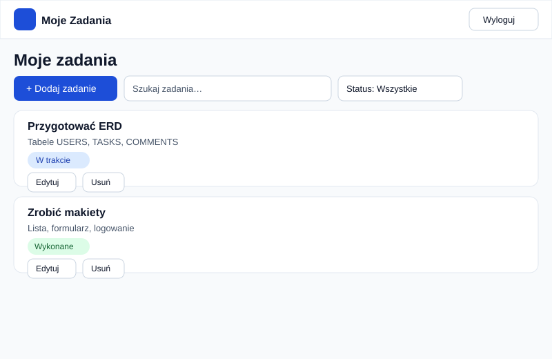
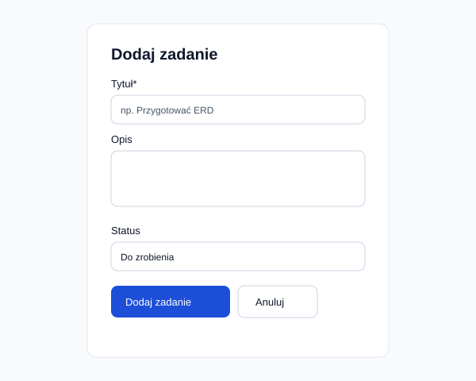
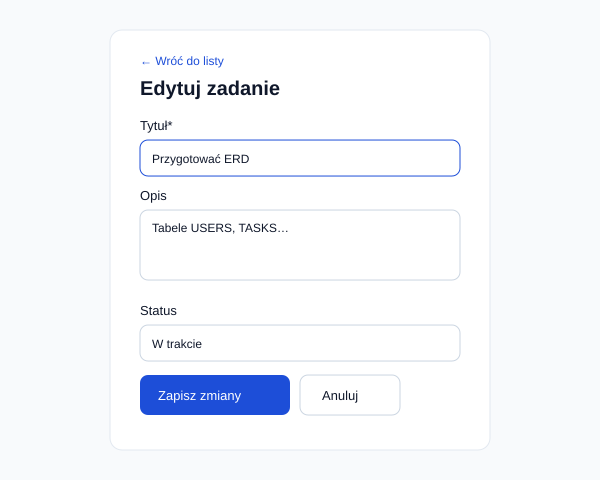
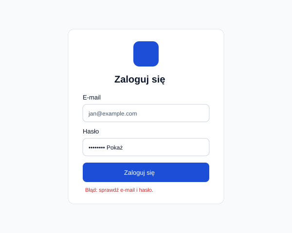

# Jak ma wyglądać aplikacja - Moje Zadania

Robiłem to na branchu `design`. Wszystko jest w folderze `docs`.

## Pomysł

Chciałem żeby było prosto i czytelnie. Jasne tło, ciemny tekst, niebieskie przyciski. Statusu nie pokazuję samym kolorem, bo to mylące, zawsze jest napis: Do zrobienia / W trakcie / Wykonane.

## Kolory

Wybrałem na coolors.co:

| Do czego | Kod | Gdzie |
|---|---|---|
| główny | `#1D4ED8` | przyciski, linki, logo |
| dodatkowy | `#0F766E` | ikony, drobne akcenty |
| tło strony | `#F8FAFC` | tło |
| karty | `#FFFFFF` | zadania, formularze |
| tekst | `#0F172A` | nagłówki, treść |
| drugi tekst | `#475569` | opisy, daty |
| błąd | `#DC2626` | usuń, błędy |

Statusy:
- Do zrobienia: tło `#E2E8F0`, tekst `#334155`
- W trakcie: tło `#DBEAFE`, tekst `#1E40AF`
- Wykonane: tło `#DCFCE7`, tekst `#166534`

### Kontrast

Sprawdzałem na webaim.org/resources/contrastchecker. Dla zwykłego tekstu trzeba min. 4,5:1.

| tekst | tło | wynik |
|---|---|---|
| `#0F172A` | `#FFFFFF` | 17,85:1 ok |
| `#0F172A` | `#F8FAFC` | 17,06:1 ok |
| `#475569` | `#FFFFFF` | 7,58:1 ok |
| `#FFFFFF` | `#1D4ED8` | 6,70:1 ok |
| `#FFFFFF` | `#0F766E` | 5,47:1 ok |
| `#FFFFFF` | `#DC2626` | 4,83:1 ok |
| `#1E40AF` | `#DBEAFE` | 7,15:1 ok |
| `#166534` | `#DCFCE7` | 6,49:1 ok |

Najpierw chciałem jaśniejszy zielony `#0D9488`, ale wyszło tylko 3,74:1 z białym, więc wziąłem ciemniejszy `#0F766E`.

## Czcionki

Z Google Fonts, muszą mieć polskie znaki:

- Nagłówki: **Poppins**, grube (600-700), ok. 24-30px. Wygląda nowocześnie, dobra do logo.
- Tekst: **Inter**, normalny 16px, mały 14px. Zwykła, czytelna, dobra do formularzy.

W kodzie:

```html
<link href="https://fonts.googleapis.com/css2?family=Inter:wght@400;500;700&family=Poppins:wght@600;700&display=swap" rel="stylesheet" />
```

## Logo

`images/logo.svg` - niebieski kwadrat i biała fajka, obok napis Moje Zadania. Proste, sam narysowałem w SVG żeby działało też jako małe.


## Ekrany

Narysowałem jako proste schematy, nie Figma. Działający podgląd jest w `frontend/index.html`.

### 1. Lista zadań

Na górze logo i wyloguj. Potem tytuł, przycisk dodaj, szukajka i filtr. Każde zadanie to tytuł, opis, status i edytuj / usuń. Jak nic nie ma to pisze że brak zadań.

```text
[logo] Moje Zadania          [Wyloguj]

Moje zadania
[+ Dodaj zadanie] [szukaj...] [wszystkie v]

-------------------------------
Przygotować ERD [W trakcie]
Tabele USERS, TASKS, COMMENTS
[Edytuj] [Usuń]
-------------------------------
Zrobić makiety [Wykonane]
[Edytuj] [Usuń]
-------------------------------
```



### 2. Dodawanie

Tytuł musi być, reszta nie. Jak klikniesz bez tytułu to wyskakuje "Wpisz tytuł zadania".

```text
Dodaj zadanie
Tytuł* [........]
Opis   [........]
Status [Do zrobienia v]
[Dodaj zadanie] [Anuluj]
```



### 3. Edycja

To samo co dodawanie, tylko pola już wpisane i przycisk "Zapisz zmiany".



### 4. Logowanie

Prosty środek ekranu, email + hasło + zaloguj. Jak złe dane to "Nie udało się zalogować. Sprawdź email i hasło".

```text
     [logo]
   Zaloguj się
Email [jan@...]
Hasło [.......]
[ Zaloguj się ]
```



## Telefon

Na telefonie wszystko w jednej kolumnie, przycisk i szukajka jeden pod drugim. Sprawdzałem zwężając okno.
