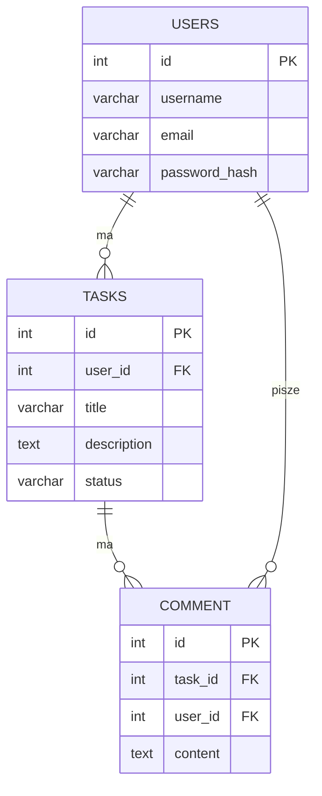

# Baza danych - ERD

Branch `diagram-erd`. Plik do otwarcia w draw.io: `docs/erd.drawio` (wchodzisz na app.diagrams.net i otwierasz ten plik).

Baza nazywa sie `taskmanager`, PostgreSQL 18.

## Tabele

**USERS** - ludzie co używają apki
- id - numer, klucz główny
- username - VARCHAR(50), musi być, unikalny
- email - VARCHAR(100), musi być, unikalny
- password_hash - VARCHAR(255), tu trzymam hash, nie hasło
- created_at - kiedy założono konto

**TASKS** - zadania
- id - klucz główny
- user_id - czyje zadanie, odnosi się do USERS(id), jak usunę usera to zadania też się kasują (CASCADE)
- title - VARCHAR(200), musi być
- description - TEXT, może być puste
- status - `todo` / `in_progress` / `done`, domyślnie `todo`
- due_date - termin, DATE, może być puste
- created_at, updated_at

**COMMENT** - komentarze (w zadaniu tabela nazywa się COMMENT, więc tak zostawiłem)
- id - klucz główny
- task_id - do którego zadania, odnosi się do TASKS(id), CASCADE
- user_id - kto napisał, odnosi się do USERS(id)
- content - TEXT, musi być, niepuste
- created_at

## Jak to się łączy

- Jeden user ma wiele zadań (USERS 1-N TASKS)
- Jedno zadanie ma wiele komentarzy (TASKS 1-N COMMENT)
- Jeden user napisał wiele komentarzy (USERS 1-N COMMENT)



## Jak odpalić

Instalacja z postgresql.org/download, Windows, version 18, same next, port zostawiasz, hasło `postgres`.

Potem w psql:

```sql
CREATE DATABASE taskmanager;
\c taskmanager
\i database/table-schema.sql
\i database/insert-data.sql
```

Cały SQL jest w `database/table-schema.sql` (tabele) i `database/insert-data.sql` (dane testowe).
