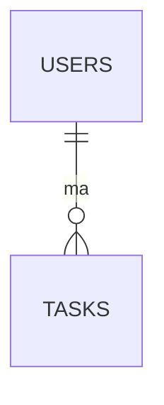

# Notatki — Markdown (zajęcia zdalne, INF.03)

Ściąga ze składni używanej w tym repo (`README.md`, `docs/`).

## Nagłówki

```md
# H1
## H2
### H3
```

## Formatowanie

*kursywa*, **pogrubienie**, `kod inline`, ~~przekreślenie~~.

## Listy

- punkt 1
- punkt 2
  - podpunkt

1. krok 1
2. krok 2

- [ ] zadanie do zrobienia
- [x] zadanie gotowe

## Linki i obrazy

```md
[tekst](https://example.com)

```

## Cytat

> To jest cytat — np. treść polecenia.

## Tabela

| Kolumna A | Kolumna B |
|---|---|
| a1 | b1 |

## Kod

```sql
SELECT * FROM tasks WHERE status = 'done';
```

## Diagram (Mermaid, działa na GitHub)

````md

````

## Checklisty do PR

- [ ] plik w dobrym katalogu (`docs/`, `database/`…)
- [ ] polskie znaki zapisane (UTF-8)
- [ ] podgląd Markdown na GitHub bez błędów
